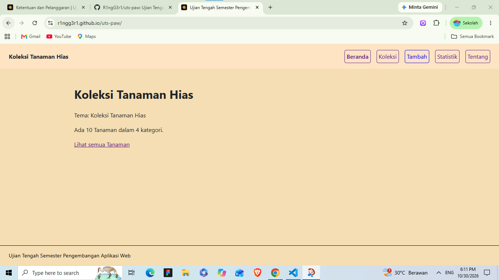
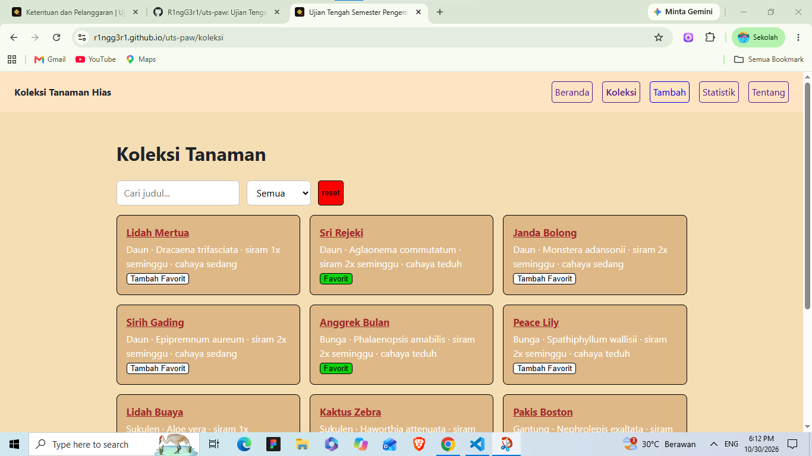
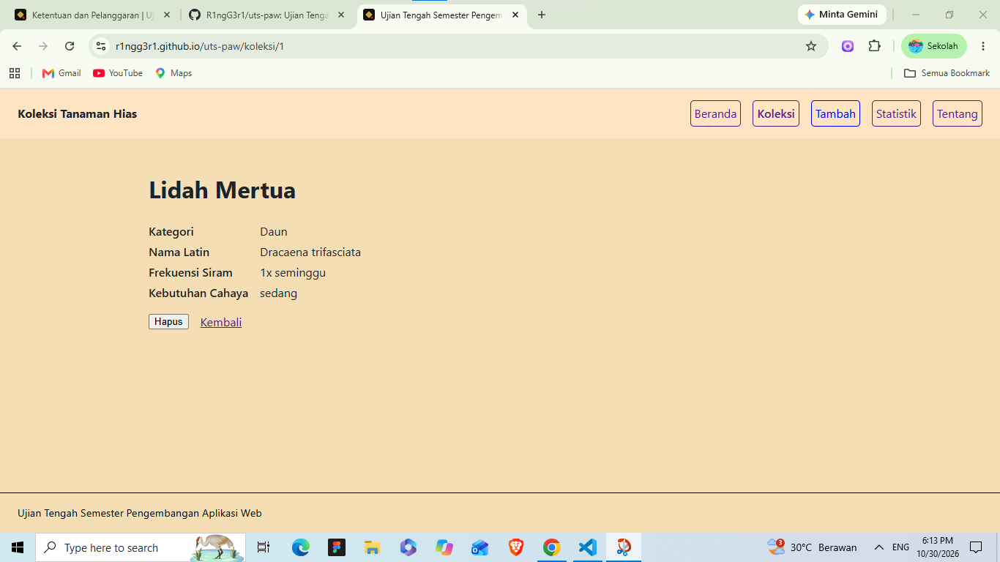
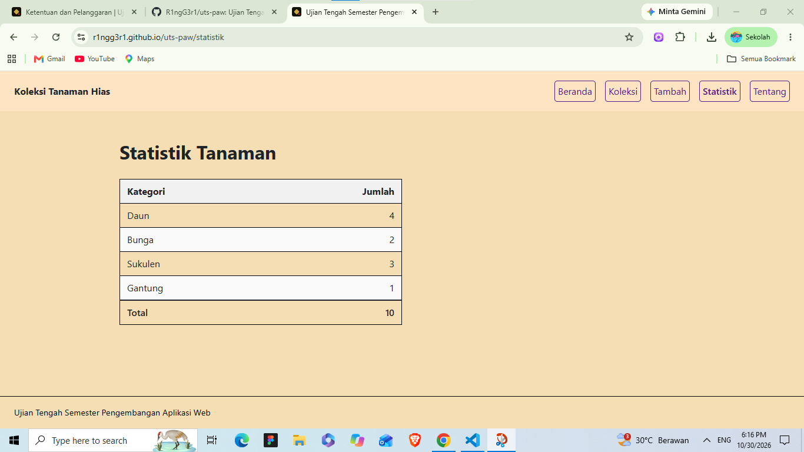
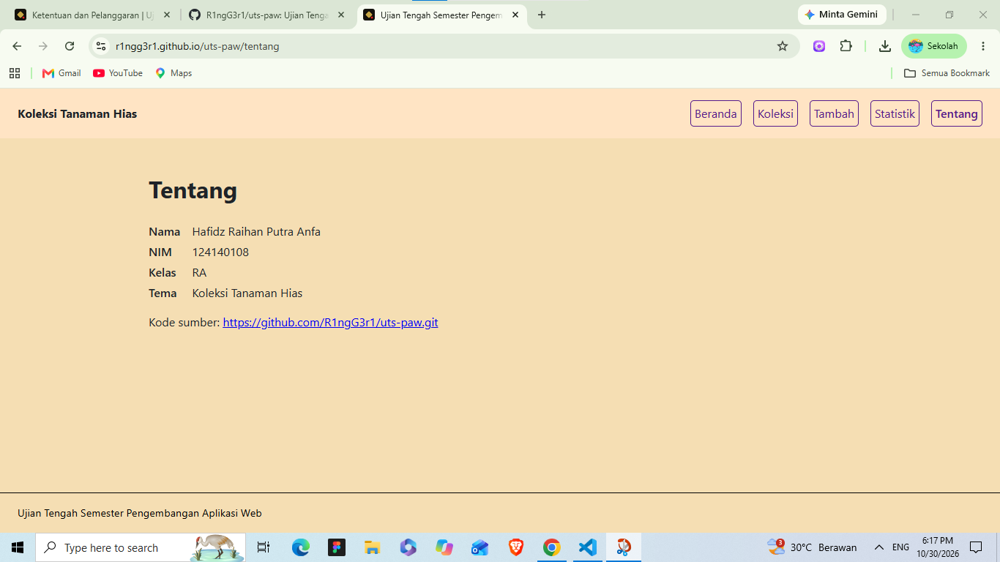
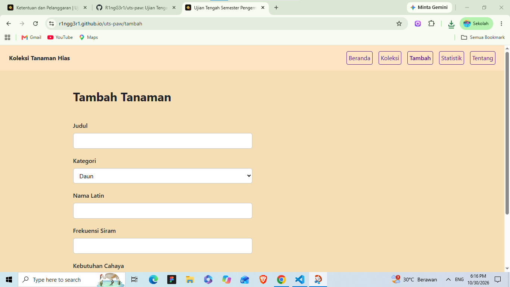

# Ujian Tengah Semester IF25-22014 Pengembangan Aplikasi Web

## Koleksi Tanaman Hias

- **Nama**: Hafidz Raihan Putra Anfa
- **NIM**: 124140108
- **Kelas**: RA
- **Tema**: Koleksi Tanaman Hias
- **Deployment**: https://r1ngg3r1.github.io/uts-paw/

### Beranda

### Koleksi

### Detail

### Statistik

### Tentang

### Tidak Ditemukan

## Fitur

- Memiliki halaman beranda, koleksi, tambah, statistik, tentang.
- Menampilkan pesan 404 pada halaman yang tidak ada.
- Menampilkan ringkasan tanaman berupa kartu pada halaman koleksi.
- memiliki fitur pencarian pada halaman koleksi.
- memiliki fitur filter untuk memfilter tanmaan berdasarkan kategori yang ada.
- memiliki fitur hapus tanaman pada halaman detail
- memiliki tombol favorit untuk tanamana pada halaman koleksi.
- memiliki tombol reset pada halaman koleksi untuk mengreset item tanaman.
- memiliki fitur tambah untuk menambahkan item tanaman pada halaman tambah.
- memiliki fitur statistik yang menampilkan total tanaman yang ada pada koleksi berdasarkan kategori.
- menampilkan data diri pada halaman tentang meliputi nama, nim, kelas, tema dan kode sumber.

## Menjalankan secara lokal

- cd app
- npm install
- npm run dev

## Konsep React yang dipakai

- Component dan props: memecah UI yang ada pada web menjadi bagin bagian kecil agar dapat digunakan kembali dan data yang dikirim dapat mengalir dari parrent ke child
- React Hook Usestate: Untuk mengelola state
- React Hook UseEffect: Untuk mengelola side Effect 
- React Hook Usecontect: Untuk memudahkan akses data global
- Fetc API dan Asyn/Wait: Untuk mengambil data dari koleksi.json
- React-Router : Untuk pengelolaan navigasi menjadi lebih mudah (Link, Navlink, USeparams)

